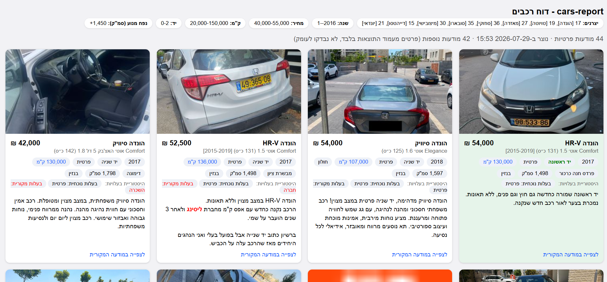

# Cars Report Generator

## Main Features

- Brings together listings from **a lot of car vendors** at once
- Removes **dealers/agencies**
- Brings each listing's **inner-page data** into the main page
- Excludes **long-distance and dangerous cities**
- Excludes cars whose km is too high or too low for their hand (**age-scaled km/year thresholds**, configurable per hand tier)
- Flags **"bad" keywords**, such as accident or rental history
- Flags **"good" cars** (first hand, low km per year)
- Embeds all images into one **self-contained HTML report** for easy sharing via WhatsApp
- Runs a **real browser** locally, under your **own profile**, with real CAPTCHA answering and random delays for natural behavior
- **Caches inner-ad results** for next time

## Setup

Requires [Node.js](https://nodejs.org/) and a locally installed Google Chrome.

```
npm install
```

## Run

```
npm run scrape
```

## What ends up in the report



- A header showing the actual search parameters used (manufacturers with resolved names, year, price, km, hand, engine size).
- Responsive card grid: image, title/trim, price, year, hand/ownership, km, city, engine size/fuel type, full description, direct link back to the original ad.
- **Km color-coding**: average km/year (total km ÷ car age) over 10,000 is marked blue; under 7,000 is marked bold green.
- **First-hand cars** and cars with a low average km/year (below the configurable `low_km_per_year_threshold`) get a highlighted green card background.
- **Ownership history**: when a car's current and original ownership type differ (e.g. started as a lease, now privately owned), both are shown - (leasing) in blue,  (rental/company) in red.
- Numbers over 1,000 (price/km/engine size) get thousand separators; years are left alone.
- Suspicious keywords (config-driven) highlighted in bold red inside the description.
- Listings beyond `max_ad_details` still appear, in a separate section below the fully-detailed ones, with whatever the results page itself shows (no extra page visits) - rendered in the same card format, showing only title/subtitle, price, year and hand (km is used only for the background highlight, not shown as a chip; city, engine/fuel type, description and ownership history aren't available without visiting the ad page, so they're omitted).
- **Sort order**, in both sections: manufacturer first (following the order manufacturers are listed in `config.yaml`'s `search.manufacturer`), then hand ascending (/1 before /2, etc.) within each manufacturer.


